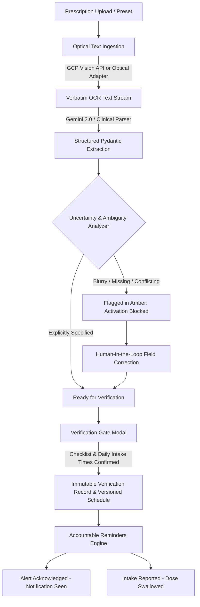

# MedBridge — Technical Architecture & Safety Specification

## 1. High-Level System Architecture

MedBridge is designed as a safety-first clinical transcription and medication routine assistant. The system connects physical prescriptions to active reminders through a five-step verified pipeline.

---

## 2. Component Design & Google Cloud Integration

### A. Optical Character Recognition (OCR)
- **Primary Live Engine**: `google-cloud-vision` (`vision.ImageAnnotatorClient().document_text_detection`)
  - Normalized word bounding box extraction `[ymin, xmin, ymax, xmax]` for visual bounding overlays.
- **Transparent Local Adapter**: When `GOOGLE_APPLICATION_CREDENTIALS` is unset, the system uses the high-fidelity local OCR adapter (`MedBridge Optical OCR Adapter`) with exact line-by-line bounding coordinates.

### B. AI Structuring & Uncertainty Detection
- **Primary Live Engine**: Google Gemini API (`gemini-1.5-pro` / `gemini-2.0` with strict JSON schema enforcement).
- **Clinical Safety Rules**:
  1. **Illegible / Smudge Rule**: Any presence of smudge markers, blurred handwriting, or unreadable words flags `instructions_as_written`, `frequency_as_written`, and `timing_as_written`.
  2. **Ambiguous / Missing Instructions**: Directions like *"Use as directed"* or *"Take as directed"* omit frequency and meal relationship. AI is strictly prohibited from inferring or hallucinating clinical instructions from general medical training.
  3. **Contradictory / Crossed-Out Directions**: Crossed-out dosages or conflicting times are flagged as high-risk contradictions requiring pharmacist consultation.

---

## 3. The Verification Gate Protocol

No medication schedule or reminder can be activated directly from AI output. Schedule activation requires:
1. **Mandatory Human Verification Checklist**: Confirmation of Medicine Name, Dosage Strength, Full Instructions, and Timing.
2. **Resolution of Flagged Uncertainties**: Unresolved uncertainties block activation with HTTP 422 unless an explicit clinical override is documented.
3. **Confirmed Daily Intake Times**: Explicit times on a 24-hour clock (e.g. `08:00`, `20:00`) must be selected.
4. **Honest Credential Labeling**:
   - If the verifier is a patient or caregiver, the schedule is stamped as **`user_reviewed`** (Awaiting Clinical Verification).
   - Only authenticated clinical reviewers (Pharmacist or Physician) can stamp a schedule as **`clinical_verified`**.

---

## 4. Reminders: Distinct Acknowledgment vs Intake

MedBridge enforces a strict distinction between alert delivery, alert acknowledgment, and user-reported intake:

| Event | Status Recorded | Clinical Meaning |
|---|---|---|
| **Notification Triggered** | `delivered` | System delivered audible Web Audio chime and visual toast alert. |
| **Acknowledge Alert** | `acknowledged = True`, `intake_reported = False` | User confirms they saw the reminder. Does **not** claim medication was taken. |
| **Mark as Taken** | `intake_reported = True`, `intake_reported_at = ISO-8601` | User or caregiver explicitly self-reports swallowing the dose with optional notes. |

---

## 5. Non-Destructive Schedule Amendments

When a schedule's instructions or times are modified:
1. The previous schedule is archived in the `history_json` array with an immutable timestamp.
2. The version increments (`v1` → `v2`).
3. An edit rationale and editor identity are mandatory.
4. An immutable audit log entry is recorded in SQLite.
